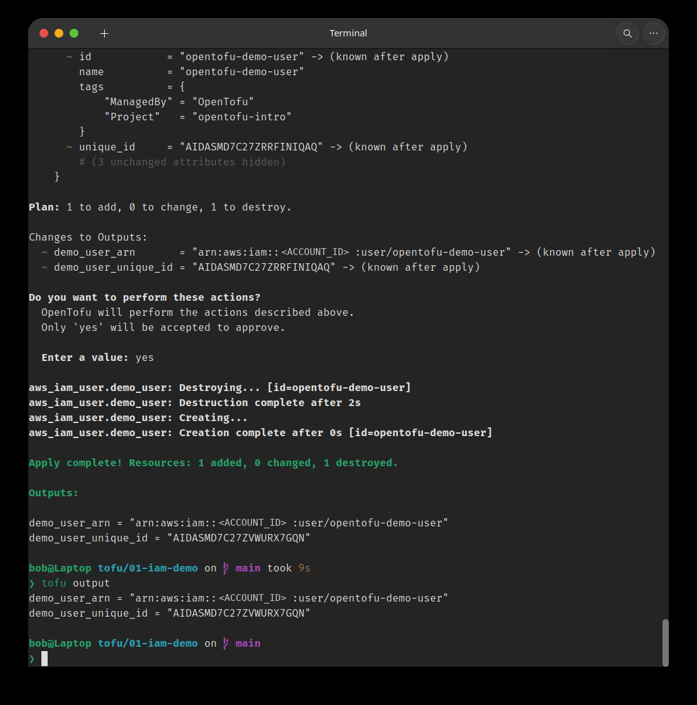
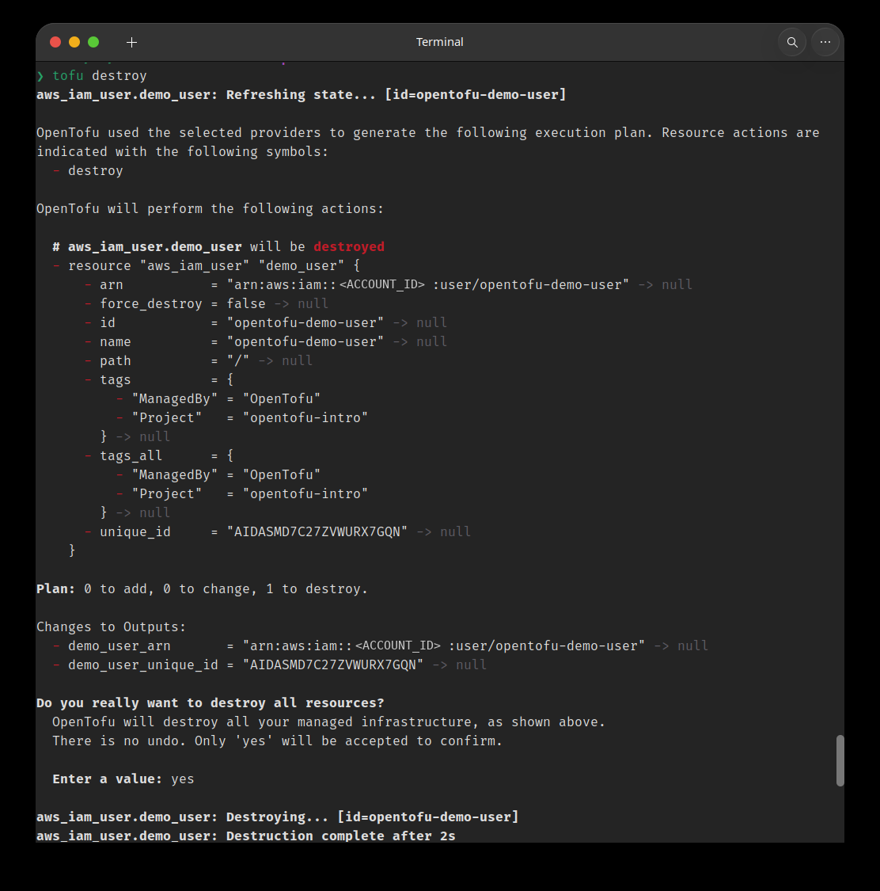
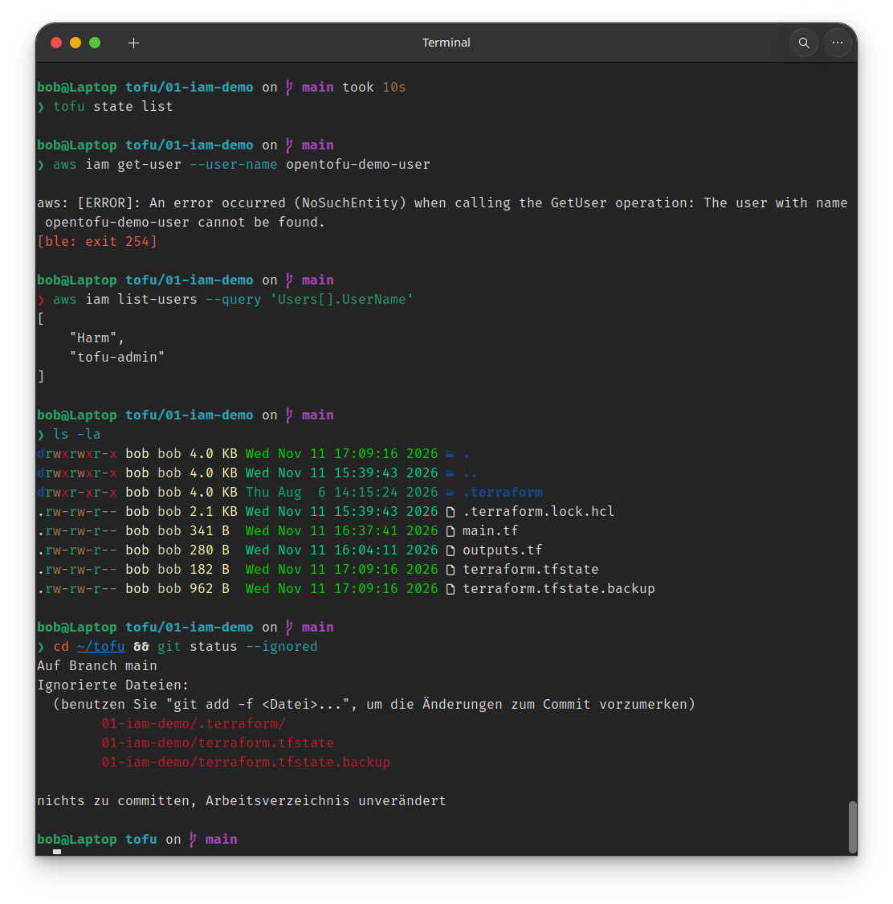

# 01 – IAM-Demo: der komplette Lebenszyklus

Ein einzelner IAM-User als Übungsobjekt. IAM-User kosten nichts und sind in Sekunden angelegt und gelöscht. Um IAM selbst geht es hier nicht, sondern um den Arbeitsablauf von OpenTofu.

| Datei | Inhalt |
|---|---|
| [`main.tf`](main.tf) | `terraform`-Block (Versionen), `provider`-Block (Region), `resource`-Block (IAM-User mit Tags) |
| [`outputs.tf`](outputs.tf) | ARN und Unique-ID des Users als Outputs |
| [`.terraform.lock.hcl`](.terraform.lock.hcl) | Festgelegte Provider-Version (`hashicorp/aws ~> 6.0`) |

## Ablauf

| Schritt | Befehl | Was dabei sichtbar wird |
|---|---|---|
| Initialisieren | `tofu init` | Provider wird geladen, Lock-Datei entsteht |
| Planen | `tofu plan` | Abgleich von Code, State und AWS: `1 to add` |
| Anlegen | `tofu apply` | User existiert, `terraform.tfstate` entsteht (per `.gitignore` ausgeschlossen) |
| State lesen | `tofu state list` / `state show` | Der State als Buchhaltung auf meiner Seite. AWS weiß nichts davon |
| Drift prüfen | `tofu plan` nach drei Monaten | `No changes`: Code, State und AWS stimmen noch überein |
| Outputs | `outputs.tf` + `tofu apply` | `0 added, 0 changed`, trotzdem neue Werte, denn Outputs liegen im State |
| Änderung in-place | Tags ergänzt | `~ update in-place`, Unique-ID bleibt gleich |
| Replace | `tofu apply -replace=aws_iam_user.demo_user` | `-/+`: erst löschen, dann neu anlegen, **neue Unique-ID** |
| Abreißen | `tofu destroy` | `- destroy`, Outputs gehen auf `null` |
| Gegenprobe | `aws iam get-user …` | AWS selbst bestätigt: `NoSuchEntity` |

## Belege

**Replace:** Gleicher Name, gleicher ARN, aber eine neue Unique-ID. Für AWS ist es ein anderer User.



**Destroy:** Jedes Attribut geht auf `null`.



**Gegenprobe:** Leerer State, `NoSuchEntity` von AWS, und `terraform.tfstate` samt `.backup` werden von Git ignoriert.



## Erkenntnisse

- **Ob ersetzt wird, entscheidet der Provider, nicht meine Vermutung.** Ich hatte erwartet, dass eine Umbenennung den User ersetzt. IAM kann User aber per API umbenennen (`UpdateUser`), also wäre auch das ein in-place update. Deshalb wird jeder Plan gelesen, bevor man `yes` tippt.
- **`-/+` heißt neue Ressource.** Bei einem IAM-User ist das harmlos. Bei einer Datenbank oder einem Volume wäre die neue Ressource leer.
- **Ein leerer State heißt nicht, dass in AWS nichts mehr existiert.** Der Nachweis kommt erst durch eine Abfrage gegen AWS.
- **Outputs brauchen ein `apply`**, auch wenn sich in AWS nichts ändert. Sie werden im State gespeichert.
- **Ein hängendes `plan` ist oft das Netzwerk.** Nach drei Monaten Pause hing `tofu plan` neun Minuten lang. `aws sts get-caller-identity` scheiterte dagegen nach vier Sekunden mit `Could not connect to the endpoint URL`. Der AWS-Provider wiederholt fehlgeschlagene Aufrufe von sich aus mit wachsenden Pausen. Die CLI ist deshalb der schnellere Test, ob es an Zugangsdaten oder Netz liegt. Ursache war ein lokales Netzwerkproblem.

## Ausführen

```bash
tofu init
tofu plan
tofu apply
tofu output
tofu destroy
```

Voraussetzung ist ein AWS-CLI-Profil mit IAM-Rechten. Der User heißt fest `opentofu-demo-user` und darf im Konto noch nicht existieren.
